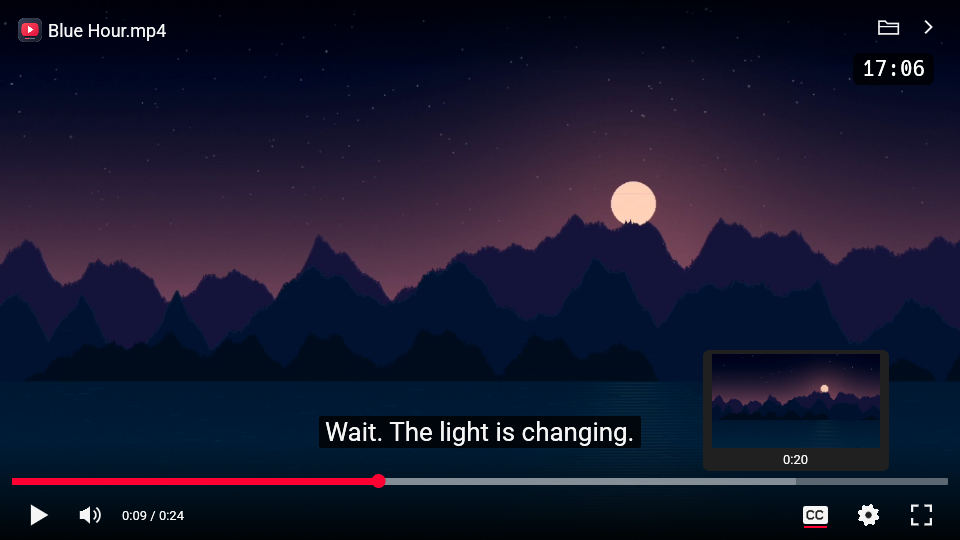
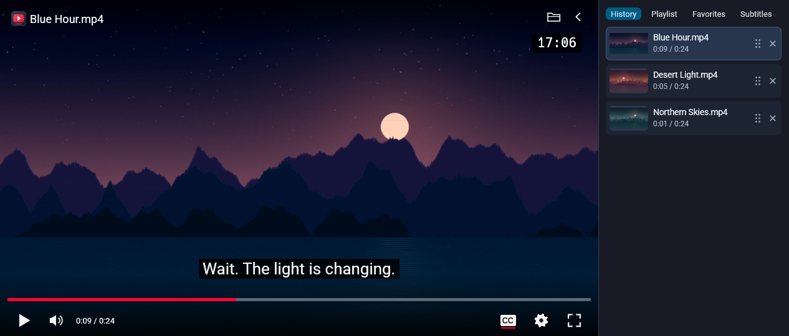
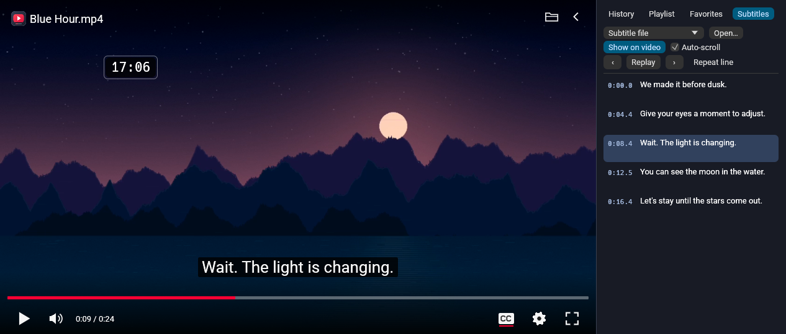

# RivPlayer

RivPlayer is a native Linux video player written in Rust for local MP4, MKV, WebM, MOV, AVI, MPEG-TS, and more. Tested video codecs include H.264, H.265 (HEVC), AV1, VP8, and VP9.

**One binary with built-in codecs.** RivPlayer compiles its container readers and software decoders directly into the executable. Play supported files without installing codec packs, FFmpeg, GStreamer, or libmpv. Optional VA-API decoding uses a compatible GPU and driver. Software decoding is available on the CPU.

RivPlayer already plays standalone audio files such as MP3 and FLAC. A dedicated music interface and support for more audio formats are planned.

## Interface



The YouTube-inspired layout keeps the seek bar, volume, **CC**, settings, and fullscreen controls close at hand. Hover over the timeline to preview a frame and its timestamp. Click the timeline, scroll over the video, or use the arrow keys to seek. The folder button opens a file, and the arrow beside it opens the library.



- **History** shows recently opened files and their saved positions. Select an entry to pick up where you left off.
- **Playlist** keeps files in order and can play the next item automatically. Add files with **Add Files** or drag them into the list.
- **Favorites** keeps selected files within reach. Choose **Add to Favorites** from the context menu in the history or playlist.



Enable **Subtitles** in the settings menu, then use **CC** to choose an embedded track or open a subtitle file. The **Subtitles** tab lists timestamped lines. Select a line to jump to it, use **Replay** to hear it again, or enable **Repeat line** to loop it. The current line is highlighted, and auto-scroll is optional.

The **Time** setting shows a clock. Drag the clock or subtitles to move them within the video. Positions are saved per file, and double-clicking an overlay resets its position. The screenshots use *Blue Hour*, a demo clip created for RivPlayer.

## Download

[GitHub Releases](https://github.com/dobrianskyi/RivPlayer/releases) provides an Arch Linux package and a Linux x86_64 archive with the executable.

**Arch Linux**

```sh
sudo pacman -U ./rivplayer-0.1.0-1-x86_64.pkg.tar.zst
```

**Linux x86_64 archive**

```sh
tar -xzf rivplayer-0.1.0-linux-x86_64.tar.gz
cd rivplayer-0.1.0-linux-x86_64
./rivplayer "/path/to/video.mp4"
```

RivPlayer uses the system's OpenGL and ALSA libraries for graphics and sound, with native Wayland and X11 window backends. The file chooser can use XDG Desktop Portal. Hardware decoding uses libva when a compatible driver is available.

## Build from source

Building requires Rust 1.95 or newer, a system linker, pkg-config, and ALSA development headers.

```sh
cargo build --release --locked
./target/release/rivplayer "/path/to/video.mp4"
```

Install NASM and build with `--features av1-simd` to enable rav1d's assembly SIMD kernels on x86-64. The default build includes multithreaded rav1d and Symphonia's SIMD optimizations.

- `--software` forces software decoding.
- `--vaapi` requires hardware decoding. In automatic mode, playback falls back to software if VA-API fails.
- `--no-default-features` is a Cargo build option that excludes VA-API.

### Build the Arch Linux package

```sh
cargo build --release --locked
./scripts/package-arch.sh --install
```

The packaging script takes the executable from `target/release/rivplayer` and writes the Arch Linux package to `dist/`. Add `--install` to install it with pacman. The package registers RivPlayer in the application menu and in **Open With** for supported video types. KDE can also use it as the default video player.

## Playback and library

- Open a file from the command line, press `Ctrl+O`, or drag a file onto the window. Without an argument, RivPlayer reopens the most recent available video at the saved position, paused. Completed videos start from the beginning. Use `--seek 0` to open a file explicitly at the beginning.
- Press `Space` or `K` for play and pause. Use `J`, `L`, `←`, or `→` to seek. The `0`–`9` keys jump to a fraction of the video. Press `F` for fullscreen and `Esc` to close a menu or leave fullscreen.
- The volume slider expands to offer up to 200% gain once it reaches 100%. Adjust volume with the slider, the wheel over the volume icon, or `↑` and `↓`. Use `M` to toggle mute and `C` to toggle subtitles.
- The settings menu offers pitch-preserving playback speeds from 0.25× to 2×. **Video track** appears when multiple video tracks are available. **Audio** selects an embedded track or loads an external audio file. The external selection is remembered per video. If the external file becomes unavailable, playback uses an embedded track. **Use original audio** restores the embedded track and clears the saved external selection.
- Videos fit inside the window while preserving their aspect ratio. The library opens to the right of the video. Its visibility, selected tab, and current playlist are saved.
- Reorder entries in **History**, **Playlist**, or **Favorites** by dragging the thumbnail or handle. Hover over an entry to see its full name and path. The context menu offers **Open in File Manager** and library actions. **Clear all history** and **Clear all playlist** clear entries from their lists.
- **Open Playlist** selects a saved list. New files go to the selected playlist or **Default Playlist**. Dropping multiple files onto the video area also starts the first file.
- Right-click the video for **File → Open…**, **Settings**, and **File Information**. **Settings → Controls** configures single-click and double-click actions and the scroll-wheel seek step. The defaults are play/pause, fullscreen, and five seconds. **File Information** shows file details and the active decoder.
- Seek previews are generated in a background thread and cached. Play and pause display a short overlay. Pausing stops the playback clock and releases queued samples. Resuming synchronizes video and audio to the saved position.
- KDE media keys and the media widget use MPRIS for play, pause, seeking, and playlist navigation.
- Local file drops work on X11 and native Wayland. Use `RIVPLAYER_WAYLAND=0` for X11 or `RIVPLAYER_WAYLAND=1` for Wayland.

History, playlists, favorites, and settings live in `$XDG_DATA_HOME/rivplayer/library.sqlite3`, with `~/.local/share/rivplayer/library.sqlite3` as the default. When upgrading from RVideoPlayer, RivPlayer automatically opens the existing database in the `rvideoplayer` directory if a new database has yet to be created.

## Subtitles and language learning

- **Subtitles → On** in the settings menu enables **CC**. Use **CC** to choose a track, open an external file, toggle **Show on video**, or select **Turn subtitles off**. **Show subtitle panel** or `Shift+C` opens the transcript. Embedded text cues are indexed in the background.
- Load external SRT, WebVTT, ASS/SSA, PGS (`.sup`), or VobSub (`.idx` with a matching `.sub`) from the menu or drop them onto the video. Files with the same base name as the video load automatically. ASS/SSA renders as plain text. The transcript lists timestamps for external bitmap subtitles.
- `Shift+←` and `Shift+→` move between lines. `Shift+↓` replays the active line. `Shift+↑` toggles its loop. Right-click any line and select **Repeat this line** to loop it.
- Press `[` to set A and `]` to set B and start repeating. `Shift+L` toggles the loop, and `Shift+R` clears both points. Points are restored per file, with repeat re-enabled manually. The player prepares the next pass while the current one is playing. **A–B** in the settings menu shows or hides the timeline buttons.
- **Time** shows a draggable clock. Set its size in **Settings → General**. **Alarm** pauses the video and shows an in-player alert after 30, 45, 60, or 120 minutes, or a custom interval.
- **Voice Boost** in the **Audio** menu emphasizes an active center channel on surround tracks or boosts the speech range in the stereo center. Toggle it during playback.
- Playback settings are saved locally. Subtitle and audio tracks, playback position, A–B points, and overlay positions can be restored per file.

## Tested containers and codecs

This table lists combinations exercised with actual media files. Support for a container depends on the codecs inside it.

| Container | Tested combinations |
| --- | --- |
| MP4 / M4A, including fragmented MP4 | H.264/AAC-LC, H.265 Main 10/AAC-LC, AV1/Opus, ALAC in M4A, and standalone AC-3 and E-AC-3 tracks in fMP4 |
| MKV / WebM | H.264 and VP8/DTS Core 5.1 in MKV, VP8/Vorbis, VP9/Opus, and AV1 in WebM |
| MOV | H.264, PCM, 24-bit ALAC, and six-channel ALAC |
| AVI | MPEG-4 Part 2 with MP3 or AC-3 |
| MPEG-TS / M2TS | H.264/AAC-LC and MPEG-2/MP2 |
| MPEG-1 System | MPEG-1/MP2 |
| MPEG-PS / VOB | MPEG-2/MP2 and MPEG-2/AC-3 |
| M4V | Variable-frame-rate H.264 |
| FLV | H.264/AAC-LC |
| Ogg / OGV | Theora/Vorbis |
| 3GP | H.264/AAC-LC |
| Standalone audio files | MP3, FLAC, AC-3, and E-AC-3 |

### Current limitations

RivPlayer targets local media without DRM. DTS-HD, TrueHD, WMA, WMV, VC-1, Sorenson Spark, embedded PGS/VobSub, and ASS/SSA styling and animation are outside the current support matrix. Seek thumbnails require a known duration. In unindexed MPEG-PS and FLV files, RivPlayer scans compressed packets for a keyframe and may need to decode from the start if it cannot find one.

For damaged MPEG-2, the decoder can use a reference frame to conceal an error. It can also skip a truncated AC-3 packet at the end of a file. The test suite exercises these paths with `TITLE01-ANGLE1.VOB`. Some Chromium samples have a green edge in the decoded chroma data. The repository documents the [sample sources](https://chromium.googlesource.com/chromium/src/%2Bshow/35bdfd670af4dff0df5aa6f27c5781affbc84070/media/test/data/README.md).

## Architecture

The [source layer](src/source.rs) gives the [playback engine](src/engine) random access to media or hands it a demuxer for split video and audio sources. The engine handles demuxing, decoding, seeking, synchronization, audio, and frame queues. The [UI](src/ui) displays frames and converts YUV to RGB in OpenGL.

The engine uses [OxideAV](https://github.com/OxideAV/oxideav-workspace), [rav1d](https://github.com/memorysafety/rav1d), [Symphonia](https://github.com/pdeljanov/Symphonia), and a pinned revision of an [OxideAV VA-API adapter](https://github.com/OxideAV/oxideav-vaapi/pull/6). The decoded video queue has a 48 MiB budget per decoding session, with room for one larger frame when the queue is empty. With VA-API, decoded surfaces pass through system memory before upload to OpenGL. Ten-bit P010 frames keep their native plane layout. Vulkan Video and a YouTube client are future work.

## Test with media files

```sh
./target/release/rivplayer --check --software video.mp4
./target/release/rivplayer --check --vaapi --seek 1.5 video.mp4
./scripts/check-media.sh
./scripts/check-media.sh --vaapi
./scripts/check-containers.sh
./scripts/check-codecs.sh
```

`--check` uses the same demuxers and decoders as the app and prints decoded frame and audio sample counts, presentation timestamps, and a luma checksum. The container suite tests variable frame rates, seeking, alternative tracks, subtitles, pause and resume, and malformed media. It also exercises subtitle navigation and A–B loops at different playback speeds using an isolated ALSA device. Samples come from [Chromium](https://chromium.googlesource.com/chromium/src/+/24db33777572825c8dc4e1fa37ece2affaa7636d/media/test/data/), the [Chromium archive](https://android.googlesource.com/platform/external/chromium_org/+/21a33e9/media/test/data/), and [kodewright/dummy-data](https://github.com/kodewright/dummy-data/tree/ab8818629d31995c4de5b10460609b5c8d7baa94/videos).

The codec suite checks timestamps and PCM after seeks, audio/video synchronization, damaged VOB playback, DTS Core against reference PCM, and bitmap subtitles. It uses public samples from the [FFmpeg sample archive](https://samples.ffmpeg.org/), the [FATE suite](https://fate-suite.ffmpeg.org/), and [libbitsub-core](https://github.com/altqx/libbitsub/tree/73c7e795808c35f4e63965e5351228d7437627f6/crates/core/src/testfiles).

Dependency licenses and source links are in the [third-party notices](docs/THIRD-PARTY-NOTICES.txt).
